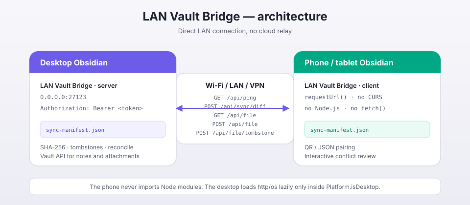
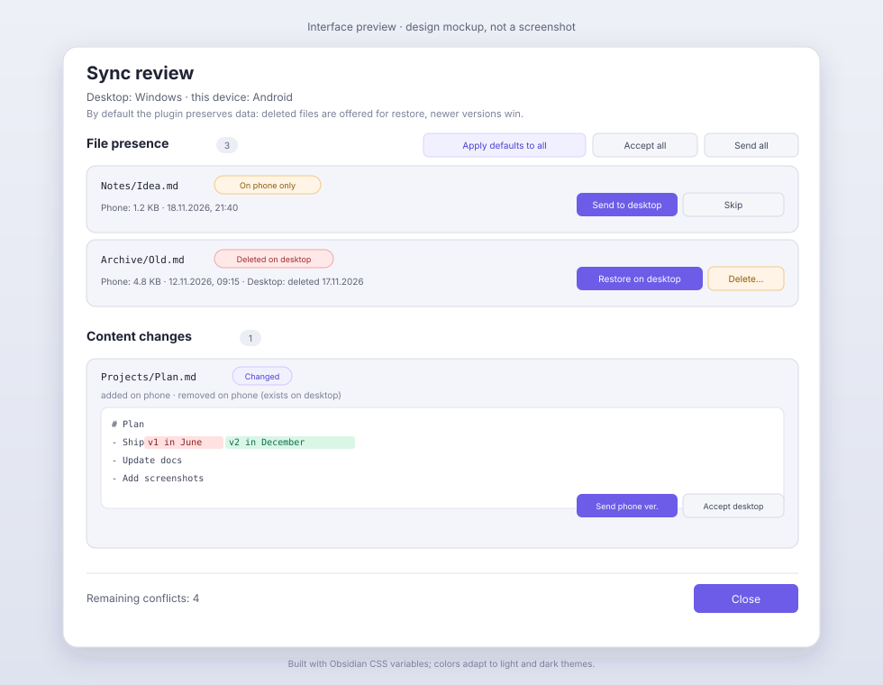

# LAN Vault Bridge

Sync your Obsidian vault between a desktop and a phone over the local network.
No cloud, no account, no relay: the desktop serves the vault, the phone connects
directly to it. Deletions are protected by tombstones, and conflicts are resolved
in an interactive review window.

> Not affiliated with Obsidian. LAN Vault Bridge is an independent community plugin.
>
> Русская версия: [README.ru.md](README.ru.md)



## Features

- **Bidirectional LAN sync.** New, changed and deleted files travel in both
  directions. The desktop runs an HTTP server; phones and other desktops are clients.
- **Zero cloud dependency.** No third-party servers, no analytics, no telemetry.
  File contents only travel between paired devices on your network.
- **Tombstone protection.** Deleting a file never silently removes its history from
  the manifest. A deleted file becomes a `deleted_tombstone` entry, so an accidental
  deletion cannot resurrect an old version or silently erase the other side.
- **Explicit conflict review.** When both sides changed the same file, or a file was
  deleted on one side and changed on the other, the plugin opens a modal window with
  previews, a word-level diff and per-file actions.
- **SHA-256 content comparison.** Hashes are computed with the browser Web Crypto API,
  identically on Electron and Android/iOS WebView.
- **QR pairing.** The desktop renders a QR code with the IP, port and bearer token;
  the phone imports the same JSON from the clipboard.
- **Bilingual UI.** English and Russian, following the Obsidian language by default.
- **Mobile-aware architecture.** Node modules are loaded lazily only on desktop.
  The phone never touches `http`, `os`, `fs` or `crypto` from Node.

## How it works

1. The desktop starts an HTTP server on `0.0.0.0:27123` (configurable).
2. The phone sends `GET /api/ping` and `POST /api/sync/diff` with its manifest.
3. The desktop reconciles its own vault, compares both manifests and returns
   `fileConflicts` and `contentDiffs`.
4. If there are no differences, the plugin shows
   “Vaults are identical: no changes found”.
5. Otherwise the review window opens. Upload, download, delete or skip each file;
   the card is marked as done and the remaining counter decreases.

The state manifest lives in `.obsidian/plugins/lan-vault-bridge/sync-manifest.json`.
It is plugin data, not a note, and is never indexed by Obsidian.

## Requirements

- Obsidian 1.5.0 or newer.
- Desktop and phone on the same LAN, or connected through a VPN such as Tailscale
  or ZeroTier.
- Windows, macOS or Linux for the server side.
- Android or iOS for the client side (the desktop can also act as a client).

## Installation

### From the community directory

Once the plugin is published: **Settings → Community plugins → Browse → search for
“LAN Vault Bridge” → Install → Enable**.

### Manual installation

Download `main.js`, `manifest.json` and `styles.css` from the latest GitHub Release
and place them in:

```text
<vault>/.obsidian/plugins/lan-vault-bridge/
```

Then reload Obsidian and enable the plugin in **Settings → Community plugins**.

### Mobile installation

Mobile Obsidian has no “install plugin from file” button. Copy the three release
files into the hidden `.obsidian/plugins/lan-vault-bridge/` folder using a file
manager that can show hidden files:

- **Android:** `Documents/Obsidian/<vault>/.obsidian/plugins/`; use ZArchiver or
  MiXplorer if the vault is in `Android/data`.
- **iOS:** Files → On My iPhone → Obsidian → `<vault>`; use Documents by Readdle,
  Finder file sharing or iMazing if `.obsidian` is hidden.

The ready-to-copy files are in the
[latest GitHub Release](https://github.com/hardkor88/lan-vault-bridge/releases/latest).

> LAN Vault Bridge cannot install itself over LAN: everything inside `.obsidian`
> is ignored by design, otherwise plugins would recursively sync themselves.

## Pairing

1. On the desktop open **Settings → LAN Vault Bridge**.
2. Choose the local IPv4 address (the list includes Wi-Fi, Ethernet, Tailscale and
   ZeroTier interfaces).
3. Scan the QR code with the phone, or press **Copy connection string (JSON)**.
4. On the phone open **Settings → LAN Vault Bridge → Quick import**, paste the JSON
   and press **Import**.
5. Press **Test connection**. A successful response shows the desktop device name
   and plugin version.

The connection string looks like:

```json
{"ip":"192.168.1.5","port":27123,"token":"0123456789abcdef0123456789abcdef"}
```

## Sync workflow

- Press the `refresh-cw` ribbon icon, run **LAN Vault Bridge: Sync now**, or use the
  button in settings.
- The client scans the vault, compares hashes and sends its manifest to the desktop.
- The review window has two sections:
  - **File presence** — only on the phone, only on the desktop, deleted on one side,
    or changed after deletion.
  - **Content changes** — active on both sides but with different SHA-256.
- Per-file actions: send to desktop, download to phone, restore, delete everywhere,
  accept the desktop version, or skip.
- Bulk actions:
  - **Apply defaults to all** — preserves data: new files are copied, deleted files
    are offered for restore, newer versions win.
  - **Accept all from desktop** — makes the phone match the desktop.
  - **Send all to desktop** — makes the desktop match the phone (this can delete
    desktop-only files; a confirmation is shown).

## Interface preview

The image below is a design preview of the conflict review window, built from the
plugin's real CSS classes. Real screenshots from a vault will be added after the
first release.



## Security and privacy

- **No third-party servers.** The plugin only talks to the paired desktop over the
  LAN. Nothing is sent to the author or to any analytics service.
- **Bearer token.** Every API request except `OPTIONS` requires
  `Authorization: Bearer <token>`. The token is 32 hex characters and can be
  regenerated in settings.
- **Plain HTTP.** Traffic is not encrypted. Use a trusted home network or a VPN.
  Do not expose port `27123` to the internet.
- **Token storage.** The token is stored in plain text in the plugin `data.json`.
  Anyone with access to the vault folder can read it.
- **Path safety.** The server rejects absolute paths, `..` traversal and everything
  inside `.obsidian` or the excluded folders.
- **Vault enumeration is local.** The plugin enumerates file paths to build and
  reconcile the manifest. The manifest is sent only to the paired desktop over the
  LAN; no file list or content is sent to the author or a third party.
- **Clipboard is user-initiated.** The clipboard is read only when you press
  “Paste from clipboard”, and written only when you press a copy button. The plugin
  never reads or writes the clipboard in the background.

## Compatibility and limitations

- `isDesktopOnly` is `false`: the plugin installs and runs on mobile as a client.
  Node.js APIs (`http`, `os`) are loaded lazily and only inside the desktop branch;
  if they are unavailable, the client still works.
- Sync starts manually. There is no background daemon, interval sync, or file watcher
  that pushes changes while Obsidian is closed.
- Default file size limit is 50 MB; it can be changed in settings. Both devices
  should use the same limit.
- Conflict resolution does not merge text automatically: you choose a version.
- Tombstones are kept indefinitely. Clearing them is a manual, irreversible action.
- Excluded folders must match on both devices, otherwise the sides will see
  different file sets.

## Development

```bash
npm install
npm run dev      # watch mode
npm run build    # typecheck + production bundle
npm run typecheck
```

The build produces a single `main.js` (CJS). `obsidian`, `electron` and
`@codemirror/*` are external; `qrcode` and `diff` are bundled.

Project layout:

```text
src/types.ts              shared interfaces and settings
src/manifest.ts           manifest, SHA-256, reconcile, tombstones, diff
src/server.ts             desktop HTTP server (lazy require('http'))
src/client.ts             requestUrl client with timeouts and SHA-256 checks
src/ui/SyncReviewModal.ts conflict review window
src/ui/ConfirmModal.ts    destructive-action confirmation
src/settings.ts           server, pairing, client and sync settings
src/main.ts               plugin lifecycle, events, ribbon and status bar
src/i18n.ts               English/Russian strings
src/logger.ts             debug logging behind a setting
```

## Release

The repository root must contain `manifest.json`, `README.md` and `LICENSE`.
For every release:

1. Run `npm run build`.
2. Create a GitHub Release whose tag exactly matches `manifest.json` version
   (for example `1.0.1`, without a `v` prefix).
3. Attach `main.js`, `manifest.json` and `styles.css` as release assets.
4. Publish the release — it must not stay a draft or pre-release.

A GitHub Actions workflow at `.github/workflows/release.yml` does steps 1–3 when a
tag is pushed. See [`SUBMISSION.md`](SUBMISSION.md) for the community directory PR.

## License

MIT — see [LICENSE](LICENSE).
